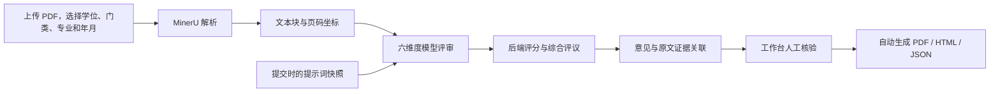

# 文衡 · 学位论文评审实验平台

**Wenheng Thesis Review Lab · 文衡谱元团队内部测试项目**

文衡面向硕士、博士学位论文，提供从 PDF 上传、模型评审到原文证据核验的实验工作台。团队可以在同一套流程中测试模型输出、迭代六个维度的评审重点，并保留每次运行的提示词版本和结果，供人工回看与分析。

[快速开始](#快速开始) · [评审维度](#评审维度) · [配置说明](docs/configuration.md) · [辅助工具](docs/tools.md)

## 适用场景

- **评审流程测试**：验证论文解析、意见生成、证据定位与报告导出的完整链路。
- **模型输出检查**：选择 GPT 或 DeepSeek 运行评审，回看不同运行的意见与证据。
- **提示词迭代**：分别调整六个维度的评审重点，保存版本，并基于已有论文重新评审。
- **团队内部使用**：通过本地账号隔离各自的论文、任务、评审重点与历史记录。

当前版本提供差异化学位论文评审、平台默认评分和答辩建议、原文证据核验及完整 PDF 报告。评分和建议属于平台辅助结果，不代表学校正式学位评审决定。

## 核心能力

| 能力 | 当前实现 |
| --- | --- |
| PDF 上传 | 单份或批量选择，最多 10 份，每份不超过 30 MB |
| 论文解析 | 接入 MinerU，保留文本块、页码和定位坐标 |
| 差异化评审 | 学士／硕士／博士 × 学术／专业学位 × 学科门类，专业按官方目录级联选择，结合完成年月 |
| 六维度评分 | 18 个分项、证据与修改建议，后端计算总分、等级和建议 |
| 综合评议 | 第二阶段汇总主要贡献、核心不足和优先修改清单 |
| 证据核验 | 原文连续阅读、页面缩放、证据高亮与意见联动 |
| 提示词版本 | 各维度独立保存，提交任务时冻结快照，支持修改后重评 |
| 任务管理 | 持久化串行队列、实时进度（解析页数、阶段耗时、预计剩余时间）、阶段检查点、失败阶段重试和中断恢复 |
| 历史与导出 | 按论文、专业、学位和等级筛选，自动生成 PDF，保留 HTML / JSON |
| 数据库 | SQLite 关系表、外键、原文证据关联和旧 JSON 安全迁移 |
| 账号管理 | 注册、登录、退出、密码修改与数据归属检查 |

### 评审维度

| 维度 | 默认关注点 |
| --- | --- |
| 选题质量 | 研究问题是否清晰，选题依据与研究目标是否一致 |
| 文献综述 | 文献覆盖与组织、比较分析及研究空白的论证 |
| 逻辑严谨性 | 前提、方法、实验与结论之间的逻辑链条 |
| 工作量 | 方法实现、数据准备、实验设计与验证是否充分 |
| 创新性及论文价值 | 实质创新、研究贡献、应用价值及其边界 |
| 论文规范性 | 术语、结构、图表、引用与表达的一致性和规范性 |

系统为每个维度提供三项详细细则和评分要求。用户可以按账号修改补充重点。首次模型调用完成六维度详细评审，第二次调用基于已完成评价生成综合评议；分数与建议由后端规则确定。详见 [评审标准](docs/review-standards.md)。

## 工作流程



调整评审重点后，可以对已有记录重新评审。重评复用原解析文本，生成新记录，旧结果和旧提示词快照保留。

## 快速开始

**本机 macOS 已配置**：双击 `START-MACOS.command` 启动并自动打开浏览器；详情见 [Mac 使用说明](docs/setup-macos.md)。原账号和历史数据保留。

### 1. 准备环境

| 依赖 | 用途 |
| --- | --- |
| macOS（Apple Silicon） | 当前适配平台；MinerU 结果解包使用系统 `unzip` |
| Node.js 24 与 npm | SQLite 驱动、HTTP 服务和测试；启动器可使用本机独立 Node 24 |
| Playwright Chromium | 服务端 PDF 生成及浏览器流程测试 |
| MinerU 凭据 | 上传新论文后的云端解析 |
| GPT 或 DeepSeek 服务配置 | 至少配置一种模型后，才能提交真实评审 |
| Codex CLI | 使用 GPT 评审路径时需要；仅使用 DeepSeek 时不需要 |
| Poppler 的 `pdftoppm` | 将 PDF 页面渲染为工作台图片 |

Python 仅用于可选的数据导出与示例生成工具，平台启动不依赖 Python。本机使用 `runtime/macos/poppler/` 中的 Poppler，该目录不上传 Git。从仓库获取项目后，需自行安装 Poppler（如 `brew install poppler`），或在 `.env` 中设置 `PDFTOPPM_BIN` 指向已有程序。

### 2. 安装并配置

获取仓库后，在项目根目录运行：

```sh
npm ci
npx playwright install chromium

# 仅在本地配置不存在时创建，避免覆盖已有凭据。
[ -f .env ] || cp .env.example .env
```

编辑 `.env`，填写 `MINERU_TOKEN`，并配置至少一条模型路径：

| 评审路径 | 必需字段 |
| --- | --- |
| GPT | `CODEX_API_KEY`、`CODEX_BASE_URL`、`REVIEW_CODEX_MODEL` |
| DeepSeek | `DEEPSEEK_API_KEY`、`DEEPSEEK_MODEL` |

模型 ID 使用服务商实际提供的值。GPT 路径通过 Codex CLI 访问支持 Responses 协议的接口；DeepSeek 路径使用 Chat Completions JSON 模式。

如果可执行文件不在 `PATH` 中，在 `.env` 中填写 `REVIEW_CODEX_BIN` 和 `PDFTOPPM_BIN` 的完整路径。更多选项见 [配置说明](docs/configuration.md)。

### 3. 启动与首次使用

```sh
npm start
```

打开 <http://127.0.0.1:4173/>：

1. 注册本地账号并登录。
2. 在“新建评审”中上传 PDF，选择学位、学位类型、学科门类、专业与完成年月，选择已经配置的模型。
3. 在右侧“评审进度”实时查看解析、评审、综合评议和报告生成进度，在工作台查看评分、综合建议及对应原文证据。
4. 下载自动生成的 PDF 报告；也可修改参数／补充重点重评，或上传修订稿。

无需下载历史数据：首次启动会自动创建 `data/` 和初始存储。没有模型凭据时仍可启动页面和使用账号功能；未配置的模型会显示原因并禁止提交。修改 `.env` 后需要重启服务。

## 项目结构

```text
wenheng-thesis-review-lab/
├── src/                     # HTTP、账号、SQLite、标准、模型、评审队列与报告模块
├── migrations/              # 带版本校验的 SQL 表结构与约束
├── assets/fonts/            # PDF 中文字体与许可
├── public/                  # HTML 页面
│   ├── js/                  # 工作台、平台导航与认证交互
│   └── css/                 # 样式与主题
├── tests/                   # 单元、DOM 与 HTTP 集成测试
├── scripts/                 # 示例生成、数据导出与真实服务核查
├── config/                  # 辅助配置模板
├── docs/                    # 配置、工具与目录迁移说明
├── data/                    # 本地私有数据，不提交
├── local/                   # 本地备份和临时文件，不提交
├── .env.example             # 无凭据的配置示例
├── .gitignore
├── package.json
└── package-lock.json
```

前端使用原生 HTML / CSS / JavaScript；后端使用 Node.js HTTP 服务、better-sqlite3 和 Playwright。PDF 中文字体随项目提供。`linkedom` 用于 DOM 测试。

## 数据与配置管理

| 本地位置 | 保存内容 | 是否提交 |
| --- | --- | --- |
| `.env` | 解析服务、模型凭据与本机运行配置 | 否 |
| `data/review.sqlite3` | 账号、论文版本、任务、评分、证据关系和标准快照 | 否 |
| `data/store.json` | 升级前 JSON；迁移后保留且不再写入 | 否 |
| `data/papers/` | 上传论文文件版本 | 否 |
| `data/reports/` | 生成的 PDF 报告 | 否 |
| `data/runs/` | 上传 PDF、解析结果、页面缓存与完整运行提示词 | 否 |
| `data/samples/` | 脚本生成的虚构论文及页面 | 否 |
| `data/audit-*` | 独立真实服务核查结果 | 否 |
| `local/` | 本地备份和临时文件 | 否 |
| `.env.example`、`config/oral-download.env.example` | 无真实凭据的配置模板 | 是 |

`.gitignore` 排除上述私有目录，以及依赖、缓存、日志、备份和常见论文/数据文件。自定义输出路径也应放在被忽略的目录中。

服务在本机运行，但真实评审会把论文交给所配置的 MinerU 和模型服务处理。Git 忽略规则只控制仓库提交，不改变这条评审数据流。

## 开发与验证

```sh
# 检查前后端 JavaScript 语法
npm run check

# 运行单元、DOM 和 HTTP 集成测试
npm test
```

测试覆盖账号隔离、历史迁移、54 种标准组合、评分与证据验证、提示词版本、阶段恢复、PDF 生成、DOM 交互以及 Chromium 桌面／手机浏览器流程。测试使用临时数据库和本地模型协议替身，通过 `REVIEW_SKIP_ENV=1` 跳过本机 `.env`，不调用收费模型。

需要验证真实模型链路时，先按 [辅助工具说明](docs/tools.md) 生成虚构示例论文，再显式执行：

```sh
npm run audit:live -- --run-live
```

该命令会调用所配置的 MinerU / GPT 服务，并将结果写入独立的 `data/audit-*` 目录；不包含在 `npm test` 中。

## 当前运行边界

- 服务仅监听 `127.0.0.1`，当前配置用于本机实验；没有提供团队共享服务器的部署方案。
- 输入格式为 PDF；任务串行处理。重启恢复排队任务，运行中任务标记中断并可从已完成阶段重试。
- 评审依据来自论文解析文本，当前没有外部文献真实性核验或全网新颖性检索。
- 原文证据关联便于人工核验，模型意见仍需团队结合论文逐项判断。
- 同时执行 DOM 和 Chromium 浏览器检查，但不意味着已经覆盖所有浏览器与设备。

## 更多文档

- [升级与验收](docs/upgrade.md)：运行时、PDF、重试、样例和验收流程。
- [数据库结构](docs/database.md)：表、外键、JSON 迁移及备份恢复。
- [本次验收记录](docs/verification.md)：实际迁移、66 项测试、真实模型核查、PDF 和备份验证结果。
- [评审标准](docs/review-standards.md)：学位差异、维度细则、评分与建议。

- [配置说明](docs/configuration.md)：模型、解析服务、端口与本地数据目录。
- [辅助工具](docs/tools.md)：虚构示例生成、真实服务核查及可选 PriorReview 数据导出。
- [目录迁移说明](docs/project-structure.md)：旧项目目录与当前结构的对应关系。
