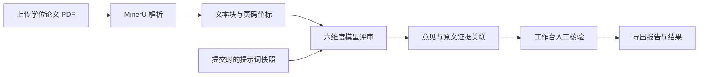

# 文衡 · 学位论文评审实验平台

**Wenheng Thesis Review Lab · 文衡谱元团队内部测试项目**

文衡面向硕士、博士学位论文，提供从 PDF 上传、模型评审到原文证据核验的实验工作台。团队可以在同一套流程中测试模型输出、迭代六个维度的评审重点，并保留每次运行的提示词版本和结果，供人工回看与分析。

[快速开始](#快速开始) · [评审维度](#评审维度) · [配置说明](docs/configuration.md) · [辅助工具](docs/tools.md)

## 适用场景

- **评审流程测试**：验证论文解析、意见生成、证据定位与报告导出的完整链路。
- **模型输出检查**：选择 GPT 或 DeepSeek 运行评审，回看不同运行的意见与证据。
- **提示词迭代**：分别调整六个维度的评审重点，保存版本，并基于已有论文重新评审。
- **团队内部使用**：通过本地账号隔离各自的论文、任务、评审重点与历史记录。

当前版本提供评审实验与人工核验工作台，尚未实现统一评分榜单、自动化模型对比或正式学位论文评审结论。

## 核心能力

| 能力 | 当前实现 |
| --- | --- |
| PDF 上传 | 单份或批量选择，最多 10 份，每份不超过 30 MB |
| 论文解析 | 接入 MinerU，保留文本块、页码和定位坐标 |
| 六维度评审 | 支持 GPT / DeepSeek，返回维度总结、问题级别、意见与修改建议 |
| 证据核验 | 原文连续阅读、页面缩放、证据高亮与意见联动 |
| 提示词版本 | 各维度独立保存，提交任务时冻结快照，支持修改后重评 |
| 任务管理 | 串行队列，记录排队、运行、成功和失败状态 |
| 历史与导出 | 按论文名筛选、查看历史，导出 HTML 报告或完整 JSON |
| 账号管理 | 注册、登录、退出、密码修改与数据归属检查 |

### 评审维度

| 维度 | 默认关注点 |
| --- | --- |
| 选题质量 | 研究问题是否清晰，选题依据与研究目标是否一致 |
| 文献综述 | 文献覆盖与组织、比较分析及研究空白的论证 |
| 逻辑严谨性 | 前提、方法、实验与结论之间的逻辑链条 |
| 工作量 | 方法实现、数据准备、实验设计与验证是否充分 |
| 创新性及论文价值 | 实质创新、研究贡献、应用价值及其边界 |
| 论文规范性 | 术语、结构、图表、引用与表达的一致性和规范性 |

默认重点在工作台中可以按账号分别修改。当前实现会将六个维度的重点合并为一次模型请求。

## 工作流程



调整评审重点后，可以对已有记录重新评审。重评复用原解析文本，生成新记录，旧结果和旧提示词快照保留。

## 快速开始

### 1. 准备环境

| 依赖 | 用途 |
| --- | --- |
| Windows / PowerShell | 当前 MinerU 结果解包使用 `powershell.exe` |
| Node.js ≥ 20.12 与 npm | 运行 HTTP 服务及前端测试 |
| MinerU 凭据 | 上传新论文后的云端解析 |
| GPT 或 DeepSeek 服务配置 | 至少配置一种模型后，才能提交真实评审 |
| Codex CLI | 使用 GPT 评审路径时需要；仅使用 DeepSeek 时不需要 |
| Poppler 的 `pdftoppm` | 将 PDF 页面渲染为工作台图片 |

Python 仅用于可选的数据导出与示例生成工具，平台启动不依赖 Python。完整解析和页面渲染流程目前面向 Windows。

### 2. 安装并配置

获取仓库后，在项目根目录运行：

```powershell
npm ci

# 仅在本地配置不存在时创建，避免覆盖已有凭据。
if (-not (Test-Path -LiteralPath .env)) {
    Copy-Item -LiteralPath .env.example -Destination .env
}
```

编辑 `.env`，填写 `MINERU_TOKEN`，并配置至少一条模型路径：

| 评审路径 | 必需字段 |
| --- | --- |
| GPT | `CODEX_API_KEY`、`CODEX_BASE_URL`、`REVIEW_CODEX_MODEL` |
| DeepSeek | `DEEPSEEK_API_KEY`、`DEEPSEEK_MODEL` |

模型 ID 使用服务商实际提供的值。GPT 路径通过 Codex CLI 访问支持 Responses 协议的接口；DeepSeek 路径使用 Chat Completions JSON 模式。

如果可执行文件不在 `PATH` 中，在 `.env` 中填写 `REVIEW_CODEX_BIN` 和 `PDFTOPPM_BIN` 的完整路径。更多选项见 [配置说明](docs/configuration.md)。

### 3. 启动与首次使用

```powershell
npm start
```

打开 <http://127.0.0.1:4173/>：

1. 注册本地账号并登录。
2. 在“新建评审”中上传 PDF，选择已经配置的模型。
3. 等待任务完成，在工作台检查评审意见及对应原文证据。
4. 按需修改评审重点并重评，或从历史记录导出结果。

无需下载历史数据：首次启动会自动创建 `data/` 和初始存储。没有模型凭据时仍可启动页面和使用账号功能；未配置的模型会显示原因并禁止提交。修改 `.env` 后需要重启服务。

## 项目结构

```text
wenheng-thesis-review-lab/
├── src/                     # Node.js 后端
│   ├── server.mjs           # HTTP 服务、任务队列、解析和模型接入
│   ├── auth.mjs             # 账号、密码与会话
│   └── prompts.mjs          # 评审维度、提示词模板与版本管理
├── public/                  # HTML 页面
│   ├── js/                  # 工作台、平台导航与认证交互
│   └── css/                 # 样式与主题
├── tests/                   # 单元、DOM 与 HTTP 集成测试
├── scripts/                 # 示例生成、数据导出与真实服务核查
├── config/                  # 辅助配置模板
├── docs/                    # 配置、工具与目录迁移说明
├── data/                    # 本地私有数据，不提交
├── local/                   # 本地备份和临时文件，不提交
├── .env.example             # 无凭据的配置示例
├── .gitignore
├── package.json
└── package-lock.json
```

前端使用原生 HTML / CSS / JavaScript；后端使用 Node.js HTTP 服务和 JSON 文件存储。运行服务没有 npm 运行时依赖，`linkedom` 仅用于开发测试。

## 数据与配置管理

| 本地位置 | 保存内容 | 是否提交 |
| --- | --- | --- |
| `.env` | 解析服务、模型凭据与本机运行配置 | 否 |
| `data/store.json` | 账号、会话摘要、任务、评审记录与提示词版本 | 否 |
| `data/runs/` | 上传 PDF、解析结果、页面缓存与完整运行提示词 | 否 |
| `data/samples/` | 脚本生成的虚构论文及页面 | 否 |
| `data/audit-*` | 独立真实服务核查结果 | 否 |
| `local/` | 本地备份和临时文件 | 否 |
| `.env.example`、`config/oral-download.env.example` | 无真实凭据的配置模板 | 是 |

`.gitignore` 排除上述私有目录，以及依赖、缓存、日志、备份和常见论文/数据文件。自定义输出路径也应放在被忽略的目录中。

服务在本机运行，但真实评审会把论文交给所配置的 MinerU 和模型服务处理。Git 忽略规则只控制仓库提交，不改变这条评审数据流。

## 开发与验证

```powershell
# 检查前后端 JavaScript 语法
npm run check

# 运行单元、DOM 和 HTTP 集成测试
npm test
```

测试覆盖账号隔离、登录注销、密码修改、提示词版本冲突、页面交互、报告转义、静态资源访问与任务失败处理。HTTP 测试使用临时数据目录和随机端口，通过 `REVIEW_SKIP_ENV=1` 跳过本机 `.env`，不调用收费模型。

需要验证真实模型链路时，先按 [辅助工具说明](docs/tools.md) 生成虚构示例论文，再显式执行：

```powershell
npm run audit:live -- --run-live
```

该命令会调用所配置的 MinerU / GPT 服务，并将结果写入独立的 `data/audit-*` 目录；不包含在 `npm test` 中。

## 当前运行边界

- 服务仅监听 `127.0.0.1`，当前配置用于本机实验；没有提供团队共享服务器的部署方案。
- 输入格式为 PDF；任务按队列串行处理，服务重启后未完成任务标记为中断，需要重新提交。
- 评审依据来自论文解析文本，当前没有外部文献真实性核验或全网新颖性检索。
- 原文证据关联便于人工核验，模型意见仍需团队结合论文逐项判断。
- 自动化 DOM 测试不等同于真实浏览器视觉及设备兼容性检查。

## 更多文档

- [配置说明](docs/configuration.md)：模型、解析服务、端口与本地数据目录。
- [辅助工具](docs/tools.md)：虚构示例生成、真实服务核查及可选 PriorReview 数据导出。
- [目录迁移说明](docs/project-structure.md)：旧项目目录与当前结构的对应关系。