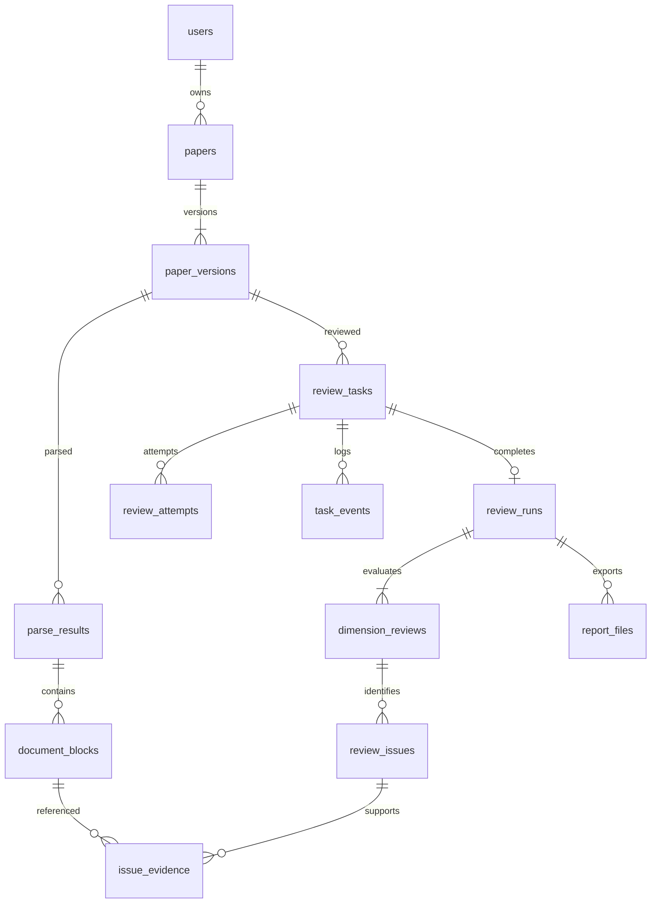

# 数据库结构与迁移

运行数据库为 MySQL（兼容 5.7 及以上；服务器为 5.7.40，本机开发使用 Homebrew 的 MySQL）。连接由 `.env` 中的 `MYSQL_HOST`、`MYSQL_PORT`、`MYSQL_USER`、`MYSQL_PASSWORD`、`MYSQL_DATABASE` 指定，驱动为 `mysql2`。

建表 SQL 位于 `migrations/001_initial.sql`。服务启动时自动建库（账号有权限时）并按编号执行未应用的迁移，同时校验已应用 SQL 的 SHA-256，不能修改已发布的迁移文件；后续结构变化必须追加编号文件。MySQL 的 DDL 会隐式提交，一个迁移文件的全部语句成功后才记录为已应用。

业务主键为字符串 UUID；时间以 UTC ISO 字符串保存，会话过期时间为毫秒整数；界面和报告按 Asia/Shanghai 展示。JSON 内容以 `LONGTEXT` 保存，由程序解析与校验。字符集统一为 `utf8mb4`。

## 一致性由谁保证

MySQL 5.7 不执行 `CHECK` 约束，原 SQLite 触发器也不再使用，以下规则改由程序保证：

| 规则 | 保证方式 |
| --- | --- |
| 取值范围（状态、级别、分数 0–100 等） | 写入前由结果校验（`src/review-schema.mjs`）和接口参数校验完成 |
| 证据必须属于同一次解析 | `saveRun` 只用本次评审的解析 ID 拼接证据块 ID；外键保证证据块存在 |
| 提交快照不可修改 | `updateTask` 只允许更新状态类字段，快照列不在可写列表中 |
| 学位类型合法 | 接口用 `validateMetadata` 校验，旧记录允许为空 |
| 同一维度提示词版本不冲突 | 保存时锁定该维度的版本行，`base_version` 不一致返回 409 |

外键、唯一约束与事务由 InnoDB 执行。数据库事务不跨越网络解析、模型调用和 PDF 渲染。

## 表与关系

| 表 | 关键字段与约束 | 用途 |
| --- | --- | --- |
| schema_migrations | version PK、checksum、applied_at | SQL 版本与校验 |
| app_meta | meta_key PK、meta_value | 数据目录根路径等元数据 |
| users | id PK、username、username_normalized UNIQUE、phone、password_hash、password_salt、created_at | scrypt 密码摘要；不保存明文密码 |
| sessions | token_hash PK、user_id FK、expires_at、created_at | 会话令牌摘要 |
| papers | id PK、owner_id FK、title、created_at、updated_at | 论文逻辑实体；owner_id 仅对无归属历史数据允许 NULL |
| paper_versions | id PK、paper_id FK、version_no、original_filename、storage_path、sha256、size_bytes、metadata_json、created_at | UNIQUE(paper_id,version_no)；按 sha256 索引，用于复用相同 PDF 的解析结果 |
| parse_results | id PK、paper_version_id FK、parser、parser_version、status、page_count、page_sizes_json、coordinate_system_json、artifact_path、error、created_at | 一次解析及坐标体系 |
| document_blocks | id PK、parse_result_id FK、source_block_id、sequence_no、page_no、block_type、text、bbox_json | UNIQUE(parse_result_id,source_block_id)；块 ID 带解析命名空间，模型只接收原始块 ID |
| standard_versions | id PK、standard_key、version、name、rubric_json、degree_profiles_json、discipline_profiles_json、scoring_rules_json、created_at | UNIQUE(standard_key,version)；已发布标准不可改用同一版本号 |
| prompt_versions | id PK、owner_id FK、owner_key（生成列）、dimension_code、version、text、note、kind、created_at | UNIQUE(owner_key,dimension_code,version)；owner_id 为空的是系统模板 |
| review_tasks | id PK、owner_id FK、paper_version_id FK、parent_run_id FK、provider、model、status、stage、request_snapshot_json、checkpoint_json、error、message、progress、各时间、dismissed_at | 参数、标准、提示词与模型配置在提交时固定；checkpoint 保存已完成阶段 |
| review_attempts | id PK、task_id FK、stage、attempt_no、status、input_path、output_path、error、起止时间 | 每次真实模型调用和纠错都有独立记录 |
| review_runs | id PK、task_id UNIQUE FK、parse_result_id FK、result_schema_version、综合评议各字段、total_score、grade、recommendation、assessment_status、compliance_json、created_at | 完成的评审；compliance_json 为专项审查结果 |
| dimension_reviews | id PK、run_id FK、dimension_code、summary、assessment_status、score、weight、score_reason、criteria_json | UNIQUE(run_id,dimension_code) |
| review_issues | id PK、dimension_review_id FK、criterion_code、severity、title、detail、suggestion、evidence_status、sequence_no | 评审意见 |
| issue_evidence | issue_id FK、block_id FK、sequence_no | 复合主键避免重复 |
| report_files | id PK、seq（自增，取最新报告）、run_id FK、template_version、status、storage_path、sha256、generated_at、error | UNIQUE(run_id,template_version)；报告失败不影响评审结果 |
| task_events | id 自增 PK、task_id FK（级联删除）、created_at、stage、level、message | 任务运行日志 |



## 本机建库

本机开发需要一个只能访问 `wenheng` 开头数据库的账号（测试会临时创建 `wenheng_test_*` 库）。用 MySQL 管理员账号执行：

```sh
mysql -uroot -p -e "CREATE USER IF NOT EXISTS 'wenheng'@'localhost' IDENTIFIED BY '<密码>'; CREATE USER IF NOT EXISTS 'wenheng'@'127.0.0.1' IDENTIFIED BY '<密码>'; GRANT ALL PRIVILEGES ON \`wenheng%\`.* TO 'wenheng'@'localhost'; GRANT ALL PRIVILEGES ON \`wenheng%\`.* TO 'wenheng'@'127.0.0.1'; FLUSH PRIVILEGES;"
```

两个账号使用同一密码，并写入 `.env` 的 `MYSQL_PASSWORD`。服务器上的库与账号在宝塔“数据库”中创建，访问权限选“本地服务器”，见 [服务器部署](deployment.md)。

## 从 SQLite 导入

升级前的数据位于 `data/review.sqlite3`。导入到 `.env` 配置的 MySQL 库：

```sh
npm run import:sqlite
# 或指定其他文件
npm run import:sqlite -- --source /path/to/review.sqlite3
```

只读打开 SQLite 文件，不修改原数据。目标库已有账号或评审任务时拒绝导入，避免覆盖。各表在一个事务中按依赖顺序复制，提交前逐表核对行数，不一致则整体回滚。此脚本使用开发依赖 `better-sqlite3`，生产镜像不包含它。

## 备份与恢复

```sh
npm run backup -- --target local/backup-20261015
```

目标目录必须尚不存在、父目录必须存在。命令用 `mysqldump --single-transaction` 导出一致的数据库快照（`database.sql`），再复制数据库引用的论文与已完成报告，输出 `manifest.json`；缺失文件单独列出。密码通过环境变量传给 `mysqldump`，不出现在命令行中。`mysqldump` 不在 `PATH` 时可设置 `MYSQLDUMP_BIN`（服务器为 `/www/server/mysql/bin/mysqldump`）。

解析附件、页面缓存、原始提示词与模型响应仍在数据目录；需要完整归档时，停止服务后另外复制整个数据目录。

恢复时先停止服务，用 `mysql` 客户端导入 `database.sql`，再把 manifest 中的文件恢复至原路径。换机器或目录时，启动器会依据 `app_meta` 中记录的数据根目录自动修正文件路径（`scripts/relocate-data.mjs`）。
