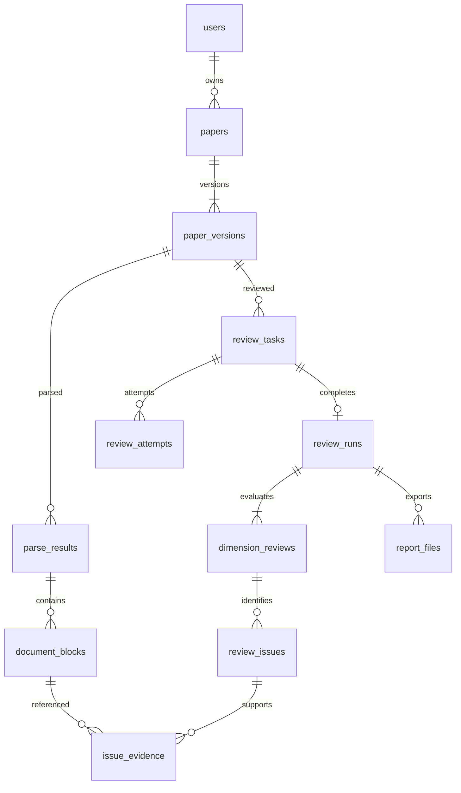

# 数据库结构与迁移

运行数据库为 SQLite。建表 SQL 位于 `migrations/001_initial.sql`；第二次迁移增加学位枚举、提交快照不可变及证据更新约束。应用按序执行迁移，并校验已应用 SQL 的 SHA-256，不能修改已发布的迁移文件。后续结构变化必须追加编号文件。

业务主键为 TEXT UUID；旧记录保留原 ID。业务时间为 UTC ISO 字符串，会话过期时间为毫秒整数；界面和报告按 Asia/Shanghai 展示。JSON 字段承载快照和不参与主要筛选的附加内容。

## 表与关系

| 表 | 关键字段与约束 | 用途 |
| --- | --- | --- |
| schema_migrations | version INTEGER PK、checksum、applied_at | SQL 版本与校验 |
| app_meta | key TEXT PK、value | 迁移来源摘要与校验报告 |
| users | id PK、username、username_normalized UNIQUE、phone、password_hash、password_salt、created_at | 保留 scrypt 密码算法；不保存明文密码 |
| sessions | token_hash PK、user_id FK、expires_at INTEGER、created_at | 会话令牌摘要 |
| papers | id PK、owner_id FK、title、created_at、updated_at | 论文逻辑实体；owner_id 仅为迁移前无账号数据允许 NULL |
| paper_versions | id PK、paper_id FK、version_no、original_filename、storage_path、sha256、size_bytes、metadata_json、created_at | UNIQUE(paper_id,version_no)，文件及上传背景 |
| parse_results | id PK、paper_version_id FK、parser、parser_version、status、page_count、page_sizes_json、coordinate_system_json、artifact_path、error、created_at | 一次解析及坐标体系 |
| document_blocks | id PK、parse_result_id FK、source_block_id、sequence_no、page_no、block_type、text、bbox_json | UNIQUE(parse_result_id,source_block_id)；数据库块 ID 带解析命名空间，模型只接收原始块 ID |
| standard_versions | id PK、standard_key、version、name、rubric_json、degree_profiles_json、discipline_profiles_json、scoring_rules_json、created_at | UNIQUE(standard_key,version)，发布后的标准不可复用版本号修改 |
| prompt_versions | id PK、owner_id FK、dimension_code、version、text、note、kind、created_at | 用户六维补充重点，按用户／维度／版本唯一；NULL owner 保存旧全局重点 |
| review_tasks | id PK、owner_id FK、paper_version_id FK、parent_run_id FK、provider、model、status、stage、request_snapshot_json、checkpoint_json、error、message、progress、起止时间 | 参数、标准、补充重点、模型配置均在提交时固定；checkpoint 保存已完成六维结果 |
| review_attempts | id PK、task_id FK、stage、attempt_no、status、input_path、output_path、error、起止时间 | 每次真实模型调用和纠错都有独立记录 |
| review_runs | id PK、task_id UNIQUE FK、parse_result_id FK、result_schema_version、overall_summary、strengths_json、limitations_json、revision_plan_json、recommendation_reason、total_score、grade、recommendation、assessment_status、created_at | 完成的评审；分数可空，否则 0–100 |
| dimension_reviews | id PK、run_id FK、dimension_code、summary、assessment_status、score、weight、score_reason、criteria_json | 每个结果每个维度唯一 |
| review_issues | id PK、dimension_review_id FK、criterion_code、severity、title、detail、suggestion、evidence_status、sequence_no | severity 限定 major/minor/positive |
| issue_evidence | issue_id FK、block_id FK、sequence_no | 复合主键避免重复；触发器禁止关联其他解析结果的块 |
| report_files | id PK、run_id FK、template_version、status、storage_path、sha256、generated_at、error | UNIQUE(run_id,template_version)，报告失败不影响评审结果 |



外键始终开启，WAL 用于本机读写，busy_timeout 为 5 秒。主要索引覆盖用户历史、任务状态、论文版本、解析块和意见。数据库事务不跨越网络解析、模型调用和 PDF 渲染。

## 旧数据迁移

```powershell
npm run migrate -- --dry-run
npm run migrate
```

默认读取数据目录下的 store.json，也可传入 `--source` 和 `--target`。迁移先备份原 JSON，然后在唯一临时数据库中导入并验证，成功后才将目标数据库激活。失败保留原文件和未激活临时文件。缺失 PDF 会在报告中列出，评审文字仍保留；重新评审时会提示文件缺失。

已有来源相同的目标数据库时再次迁移返回 already-migrated。已有不匹配数据库时拒绝覆盖。导入记录不会依据同名文件合并；无法确认关联的旧运行分别建论文。旧任务缺少提交文件和参数的，归档为不可恢复失败任务。旧运行没有元数据与评分时保存 NULL，不补造分数。

首次启动若只有旧 JSON、没有 SQLite，也执行相同安全迁移。切换后应用不再写旧 JSON。系统通过现有首次注册流程把迁移前无归属的数据分配给第一个本机账号；已有用户之间的归属保持不变。

## 备份与恢复

```powershell
npm run backup -- --database data/review.sqlite3 --target local/backup-20261011
```

目标目录必须尚不存在、父目录必须存在。命令使用 SQLite 在线备份 API 得到一致数据库快照，并复制快照引用的论文与已完成报告，输出 manifest.json。文件缺失会单独列出。解析附件、页面缓存、原始提示词与模型响应仍在原数据目录；需要完整归档时应在停止服务后另外复制整个数据目录。

恢复时先停止服务，保留当前数据目录的备份，再恢复快照数据库和 manifest 中列出的文件至原路径。换机器或目录时，依据 manifest 更新 paper_versions.storage_path、report_files.storage_path，以及解析附件和调用记录的路径。不要单独复制运行中数据库的主文件而遗漏 WAL，也不要把切回旧 store.json 当作包含新数据的回滚。
